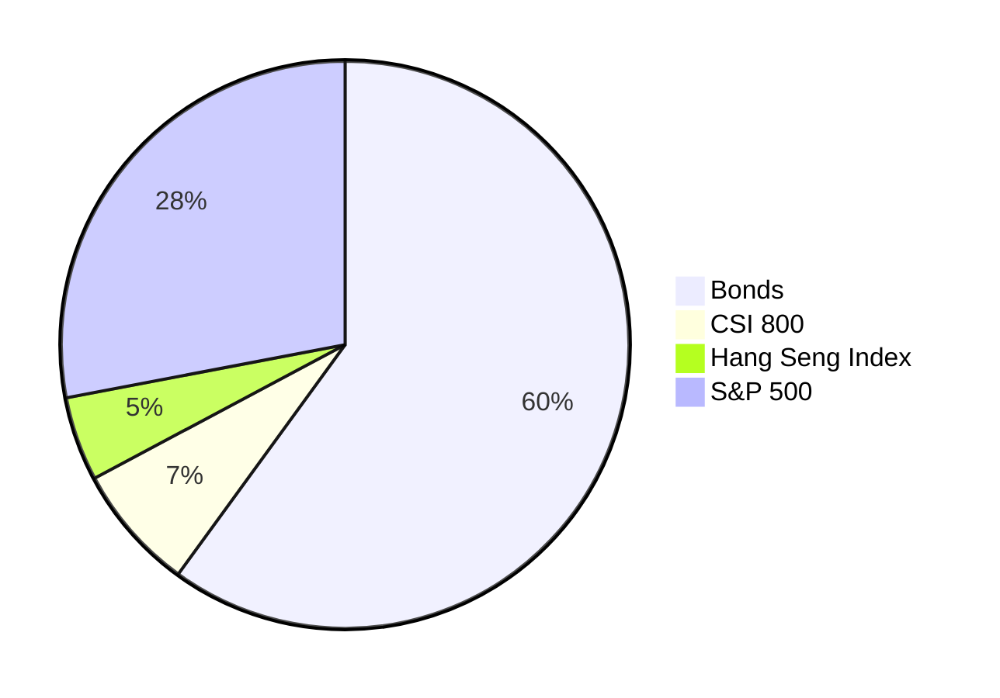
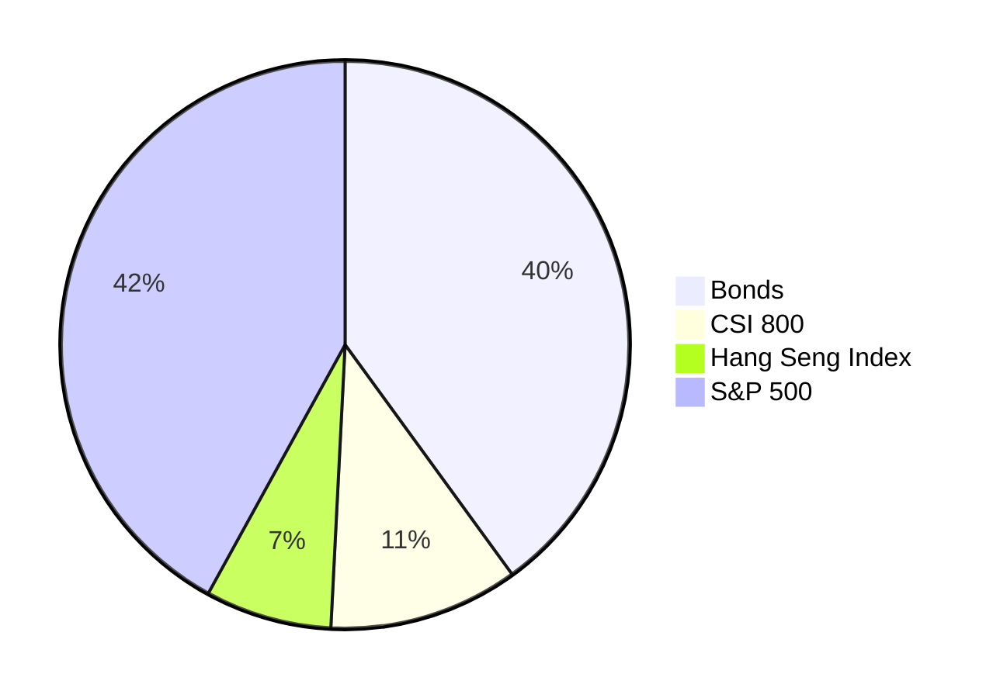
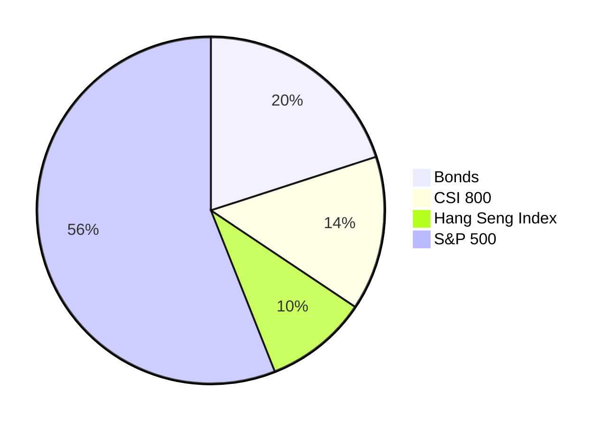
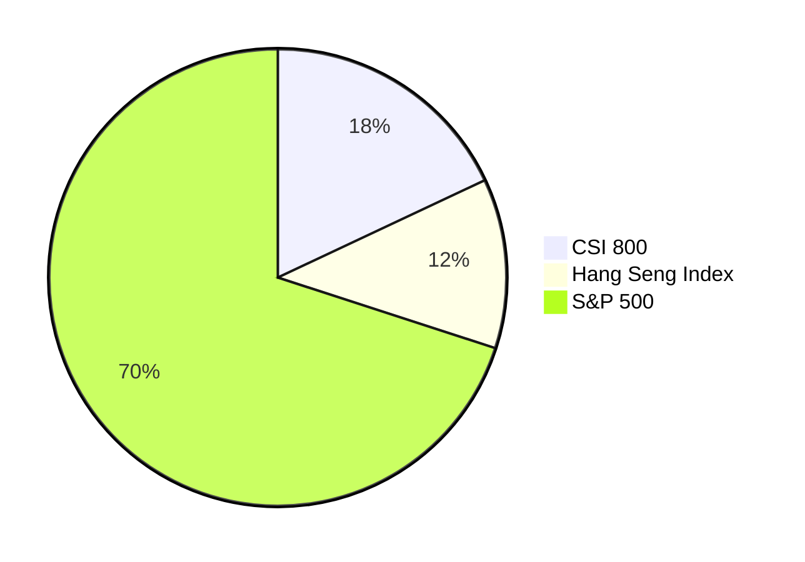

# Chinese Couch Potato investing

Canada's [Canadian Couch Potato](https://canadiancouchpotato.com/) is a useful guide to low-cost, passive index investing. This note adapts that approach for Chinese domestic investors through a set of example "couch potato" portfolios.

_Last updated: Oct 2026. Fund fees, returns, tax rates, and rules change over time — check the current numbers before you act._

**Not financial advice.** This note reflects my personal views and is intended for general education. It is not financial, legal, tax, or accounting advice. Fund details, tax rules, and individual circumstances vary, and the estimates in this note may be incorrect. Do your own research and consider consulting a licensed adviser before investing.

**For most people, a simple, passively managed mix of low-cost, broad stock and bond index funds is a sensible place to start.**

Key takeaways:

- Invest a fixed amount regularly and hold for the long term. This reduces the temptation to react to market news.

- After fees, most active funds _underperform_ the market.

- Factor tilts, such as value, have worked in the past but may not continue to do so. For most people, they are not worth the added cost and complexity.

- Avoid trying to time the market. It is one of the most damaging habits investors can develop.

- Day trading and crypto are closer to speculation than long-term investing and are excluded from this approach.

- Picking individual stocks or popular sectors also tends to underperform the broader market.

## Available asset classes

Investors in China can access these asset classes through mutual funds and ETFs:

- Chinese domestic bonds: Prefer policy-bank bonds (政策性金融债) and central government bonds (国债) over corporate bonds.
- A-shares: Prefer the CSI 800 Index (中证800), which covers large- and mid-cap stocks.
  - Alternative: CSI 300 Index (沪深300), which covers large-cap stocks only.
- Hong Kong-listed stocks: Prefer the Hang Seng Index (恒生指数), a broad large-cap index representing about 60% of the Hong Kong stock market by capitalization.
  - Alternative: Hang Seng China Enterprises Index (恒生中国企业指数), which focuses on companies closely tied to the mainland, not including local Hong Kong companies.
- U.S. large-cap stocks: Prefer the S&P 500, available through QDII funds.
- Other international markets, such as Europe and Japan, are accessible with higher fees.

## Representative funds

The following funds are representative examples of low-cost index products available to investors.

| Asset class             | Mutual fund example (基金示例) | Ticker          |
| ----------------------- | ------------------------------ | --------------- |
| Bonds                   | 易方达新综债LOF                | 161119 场内     |
| A-shares                | 易方达中证800ETF               | 515810 场内     |
| Hong Kong-listed stocks | 恒生ETF                        | 159920 场内     |
| U.S. large-cap stocks   | 摩根标普500指数                | 017641 **场外** |

Notes:

1. These funds are examples, not recommendations. Check each fund's current fees before investing. For the bond allocation, term deposits (定期存款) are another simple, low-risk option with no fund management fee.

## Methodology

Many Chinese investors don't invest in international. An all-A-share portfolio, or an A+H portfolio, has worse expected risk-adjusted returns. A standard deviation of 20% is already high, and a concentrated portfolio of individual A-shares can fluctuate even more without offering a higher expected return. Like investors elsewhere, Chinese investors should be cautious about this home bias. Holding international stocks can improve diversification and reduce overall volatility.

These portfolios begin with [equity-allocation optimization](chinese-couch-potato-technical-note.md) and are then adjusted manually to account for practical diversification considerations. The model portfolios in this note use an **18/12/70** split.

### Asset-selection considerations

#### Other international markets

Europe and Japan are not included because suitable low-cost index funds remain limited. Future versions may include them if better options become available.

#### Gold

Gold is excluded because it produces no income, has delivered roughly flat long-run real returns, and can be almost as volatile as stocks. Bonds generally provide more reliable portfolio stability while producing income. A small allocation of up to 10% in place of bonds may still be reasonable for investors who want additional diversification.

#### Commodities

Commodities share many of gold's drawbacks: high volatility, low expected returns, and limited access through suitable index funds. They are therefore excluded.

#### Factor/sector tilts

Avoid tilting toward quality, value, dividends (红利), low volatility (低波动), or other factors. Their future premiums are uncertain, and the funds generally cost more. To reduce risk, add bonds rather than relying on a factor tilt. For the equity sleeve, use broad, market-cap-weighted index funds.

Avoid sector tilts as well. Choosing the Nasdaq-100 over the S&P 500 is largely a bet on technology and may amount to performance chasing.

## Model portfolios

### 40% stocks/60% bonds "Conservative"

### 60% stocks/40% bonds "Balanced"

### 80% stocks/20% bonds "Growth"

### 100% stocks "Aggressive"

